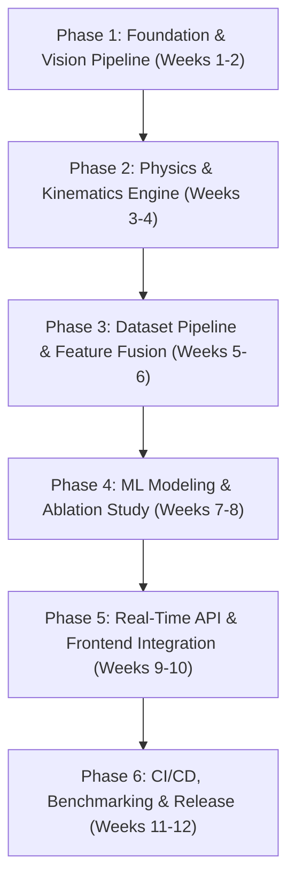

# 🗺️ Project HandShayak: Development Roadmap

> **Physics-Informed Sign-Language Recognition**  
> Modeling the human hand as a biomechanical rigid-body linkage to distinguish visually similar signs using kinematics and dynamics.

---

## 👥 Team & Ownership Matrix

| Member | Primary Role | Core Modules & Deliverables |
| :--- | :--- | :--- |
| **Debonnita** | Vision Pipeline Developer | MediaPipe 3D Landmark extraction, tracking stability, coordinate normalization |
| **Jai Krishna** | Physics Engine Developer | Kinematics ($v, a, \text{jerk}$ via Savitzky–Golay) & Dynamics ($KE, I, \tau$, torque) |
| **Koushik** | Data Engineer & QA | Dataset acquisition/synthesis, feature vector fusion, Pytest test suites |
| **Harsimran** | ML & Backend Architect | Feature classification (SVM, RF, ONNX), FastAPI backend, WebSocket streaming |
| **Monojoy** | Frontend Lead | Web UI (React/Vite or Streamlit/Canvas), real-time camera feed & physics overlays |
| **Krishnendu** | DevOps Lead | Docker containers, GitHub Actions CI/CD, cloud deployment, benchmarking |

---

## 🗓️ Phase-by-Phase Roadmap

---

### 📍 Phase 1: Foundation, Environment & Vision Pipeline (Weeks 1–2)
**Goal:** Establish reproducible development environments, repository architecture, and robust real-time 3D hand landmark capture.

- [ ] **Repository Scaffolding & Tooling** *(Krishnendu)*
  - Setup directory structure (`src/vision`, `src/physics`, `src/data`, `src/models`, `src/api`, `tests/`).
  - Configure `pyproject.toml` / `requirements.txt`, pre-commit hooks (`black`, `flake8`, `isort`).
- [ ] **MediaPipe 3D Landmark Extraction** *(Debonnita)*
  - Capture real-time frames via OpenCV and extract 21 MediaPipe hand keypoints in 3D world coordinates (`x, y, z`).
  - Implement coordinate normalization relative to wrist root and palm scale (invariance to hand distance from camera).
- [ ] **Initial Unit Tests & Mock Pipeline** *(Koushik)*
  - Setup `pytest` infrastructure and mock landmark fixtures for downstream developers.

**Milestone 1:** Stable 30+ FPS stream capturing normalized 3D hand landmark coordinates.

---

### 📍 Phase 2: Kinematics & Biomechanical Physics Engine (Weeks 3–4)
**Goal:** Transform noisy raw coordinate trajectories into physically accurate kinematic and dynamic features.

- [ ] **Trajectory Smoothing & Derivative Computation** *(Jai Krishna)*
  - Implement Savitzky–Golay filter to eliminate landmark jitter without introducing phase lag.
  - Compute 1st, 2nd, and 3rd numerical time derivatives:
    - Linear/angular velocity ($v, \omega$)
    - Linear/angular acceleration ($a, \alpha$)
    - Jerk ($j = \frac{da}{dt}$)
- [ ] **Biomechanical Dynamics Modeling** *(Jai Krishna)*
  - Model hand phalanges and palm as segmented rigid bodies with anthropometric mass estimations ($m_i$) and moments of inertia ($I_i$).
  - Calculate total Kinetic Energy:
    $$KE = \sum \frac{1}{2} m_i v_i^2 + \sum \frac{1}{2} I_i \omega_i^2$$
  - Calculate inferred joint torque and net impulse ($J = \int F dt$).
- [ ] **Physics Unit Testing & Validation** *(Koushik)*
  - Validate kinematic conservation laws and filter stability against synthetic ground-truth trajectories (e.g., pure harmonic motion).

**Milestone 2:** Verified physics module outputting time-series feature tensors ($v, a, j, KE, \tau$) from landmark streams.

---

### 📍 Phase 3: Data Engineering & Feature Vector Fusion (Weeks 5–6)
**Goal:** Build a robust data collection protocol and fuse visual shape features with physical dynamic features.

- [ ] **Sign Language Gesture Dataset Collection** *(Koushik, Debonnita)*
  - Record target sign classes with intentional dynamic contrasts (e.g., gentle vs. forceful tap, slow swipe vs. rapid flick).
  - Multi-subject recording under varying lighting and camera angles.
- [ ] **Feature Aggregation & Windowing** *(Koushik, Jai Krishna)*
  - Sliding window extraction over gesture duration ($T \approx 0.5 - 2.0\text{ s}$).
  - Extract static features: joint angles, pairwise distances, palm orientation.
  - Extract dynamic features: peak velocity, max acceleration, jerk integral, energy expenditure profile.
- [ ] **Data Pipeline Automation & Versioning** *(Koushik, Krishnendu)*
  - Automated feature extraction pipeline (`dvc` or structured NumPy/HDF5 format).

**Milestone 3:** Labeled, preprocessed dataset with shape and physics feature vectors ready for model training.

---

### 📍 Phase 4: Machine Learning Modeling & Ablation Studies (Weeks 7–8)
**Goal:** Train baseline and physics-augmented classifiers; empirically validate the physics-informed hypothesis.

- [ ] **Model Architecture & Training** *(Harsimran)*
  - Baseline classifiers: Random Forest, SVM, LightGBM / XGBoost.
  - Sequential/Temporal models: 1D-CNN or BiLSTM on physics feature sequences.
- [ ] **Comprehensive Ablation Study** *(Harsimran, Koushik)*
  - **Model A (Baseline):** Static Shape Features only.
  - **Model B:** Dynamic Physics Features only ($v, a, \text{jerk}, KE$).
  - **Model C (HandShayak):** Shape + Physics Fused.
  - Measure accuracy, confusion matrices on visually ambiguous gesture pairs, and F1-scores.
- [ ] **Model Optimization & ONNX Export** *(Harsimran)*
  - Export trained models to ONNX runtime for sub-10ms inference latency.

**Milestone 4:** Benchmark report demonstrating superior accuracy of HandShayak over shape-only baselines, with exported ONNX models.

---

### 📍 Phase 5: Real-Time Streaming Backend & Interactive UI (Weeks 9–10)
**Goal:** Deliver an end-to-end live prototype running inference over WebSockets.

- [ ] **FastAPI & WebSocket Streaming Server** *(Harsimran)*
  - Build asynchronous WebSocket endpoint accepting landmark sequences and returning real-time predictions.
  - In-memory ring buffer for streaming sliding-window physics computations.
- [ ] **Frontend Application & Visualizer** *(Monojoy)*
  - Web interface with webcam feed (WebGL / Canvas overlay).
  - Real-time kinematic telemetry dashboard: display live speedometers, energy graphs, and recognized signs.
- [ ] **Frontend-Backend Integration** *(Monojoy, Harsimran)*
  - Bi-directional WebSocket communication with latency monitoring and reconnection handling.

**Milestone 5:** Fully interactive live demo classifying signs from webcam video with real-time physics telemetry.

---

### 📍 Phase 6: Containerization, CI/CD, Benchmarking & Release (Weeks 11–12)
**Goal:** Production hardening, deployment, open-source documentation, and research artifacts.

- [ ] **Dockerization & Multi-stage Builds** *(Krishnendu)*
  - Optimized Docker image for API and frontend services (CPU-optimized ONNX runtime).
- [ ] **CI/CD Pipeline** *(Krishnendu)*
  - GitHub Actions for linting, testing (`pytest`), building Docker images, and automated tagging.
- [ ] **Performance Benchmarking & Profiling** *(Krishnendu, Jai Krishna)*
  - End-to-end latency profiling: MediaPipe capture $\rightarrow$ Kinematics $\rightarrow$ Inference $\rightarrow$ UI response ($< 50\text{ ms}$ budget).
- [ ] **Documentation & Project Wrap-up** *(All Hands)*
  - Comprehensive API documentation, demo video, final paper/project report with ablation graphs.

**Milestone 6:** Production-ready containerized release (v1.0.0) with automated CI/CD and public documentation.

---

## ⚡ Critical Path & Risk Management

| Risk | Impact | Mitigation Strategy |
| :--- | :--- | :--- |
| **MediaPipe noise propagates into high jerk values** | High | Apply 2nd-order Savitzky–Golay or Kalman filtering; clamp unphysical derivative spikes. |
| **Latency buildup in sliding window** | High | Pre-compute derivatives incrementally in circular buffers; run ONNX on CPU with multi-threading. |
| **Overfitting on small gesture datasets** | Medium | Data augmentation (temporal warping, spatial scaling, noise injection) and cross-subject validation. |
| **Camera frame rate fluctuations (FPS jitter)** | Medium | Use variable $\Delta t$ based on hardware timestamps rather than assuming a fixed $1/30\text{ s}$. |
